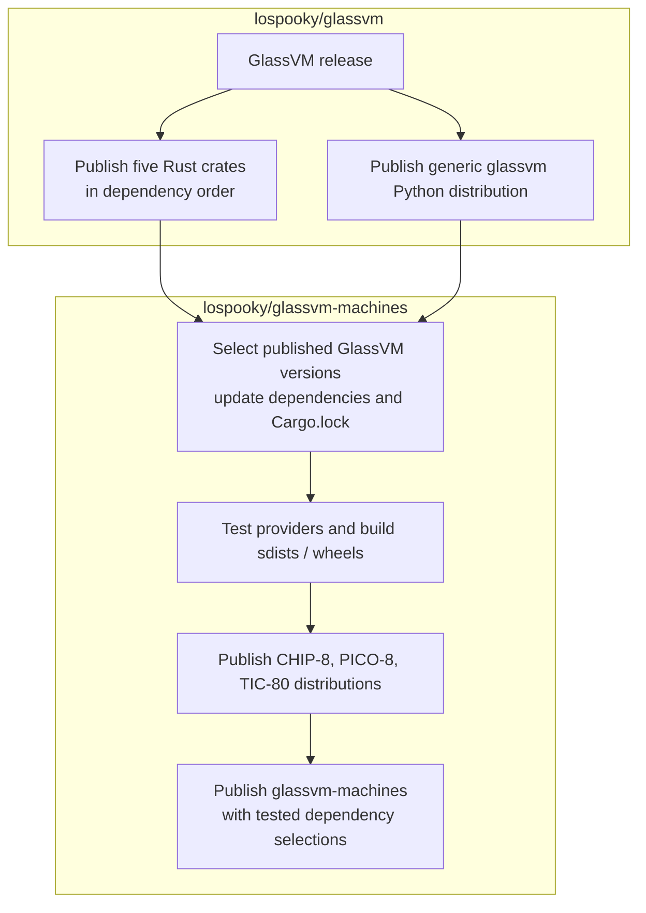

# Independent GlassVM and machine releases

Status: approved and implemented in release workflows; first independent release
is in progress.

This decision replaces the coordinated publication scheme in which GlassVM
waits for matching machine package versions before publishing its Python facade.
The GlassVM release now completes without checking whether machine wheels have
been published. The machine release consumes published GlassVM crates and the
generic facade.

## Release ownership

`lospooky/glassvm` publishes the five machine-neutral Rust crates and the generic
`glassvm` Python distribution. Its release completes independently of the
machines repository.

`lospooky/glassvm-machines` selects published GlassVM dependencies, validates its
providers against them, and publishes the CHIP-8, PICO-8, and TIC-80 Python
distributions. It also owns a metadata-only convenience distribution named
`glassvm-machines` for selecting tested package combinations.

The machines repository depends on GlassVM releases. GlassVM publication has no
dependency on a machine release. Repository versions may advance independently;
matching version numbers across repositories are not a compatibility rule.
Each repository may continue coordinating its own package versions internally.

## Release sequence



1. GlassVM validates its source and packages, then publishes its Rust crates in
   dependency order: `glassvm_normalizer_contract`, `glassvm_core`, followed by
   `glassvm_recorder`, `glassvm_query`, and `glassvm_registry`. Newly published
   dependencies must be available from the registry before dependent packages
   are published.
2. GlassVM publishes its generic Python facade without waiting for machine
   distributions. The facade contains no machine dependencies or bundle-selection
   extras.
3. The machines repository chooses the published Rust and Python versions it
   will support, updates its manifests and registry-resolved lockfile, and tests
   preparation, execution, sink delivery, and installed provider discovery.
4. The machines release builds and publishes its three provider distributions.
5. After its selected dependencies are available on the package index, the
   machines repository publishes the convenience distribution containing the
   tested package selections.

No cross-repository release waiter or reverse trigger is required. Begin with
manual dependency updates; a future automation may open a dependency-update PR
in the machines repository without automatically publishing a release.

## The convenience distribution

`glassvm-machines` contains dependency metadata only. It declares a tested
`glassvm` facade dependency and provides `chip8`, `pico8`, `tic80`, and `all`
extras selecting the corresponding provider wheels. It introduces no runtime
module, emulator, provider, native extension, or discovery mechanism.

Installation through that distribution becomes:

```bash
uv pip install 'glassvm-machines[chip8]'
uv pip install 'glassvm-machines[all]'
```

Callers may also install the facade and individual bundles directly:

```bash
uv pip install glassvm glassvm-chip8
```

The convenience distribution pins exact versions for its tested combinations.
Those versions need not match each other or the convenience package version.
Extras select ordinary package dependencies; source builds retain the existing
explicit source-distribution build requirements.

Move the existing machine-selection extras out of `glassvm`. The approved
installation surface is `glassvm-machines[...]`; the old `glassvm[...]` bundle
extras are removed without compatibility aliases.

## Compatibility and dependency declarations

Each provider distribution declares the generic facade versions it supports
through its Python dependency metadata. Initially, an exact tested version is
appropriate; broader ranges require evidence that the covered facade/provider
combinations work.

Provider compatibility remains governed by `glassvm.python_bundle` and its
supported numeric protocol metadata. Independent package versions do not weaken
protocol validation. A breaking provider-interface change must be reflected in
the supported protocol metadata and package requirements; existing providers
must not be assumed compatible merely because discovery succeeds.

Machine source builds consume published GlassVM Rust dependencies, with the
machine lockfile resolving the selected registry artifacts. Machine-specific
Rust crates remain internal build components with `publish = false`. Provider
sdists retain their complete machine source closure. Prebuilt wheels already
contain the compiled Rust implementation.

## Implemented workflow direction

- Remove GlassVM's PyPI polling step for machine releases.
- Remove validation requiring machine dependency versions to equal the GlassVM
  release tag. Validate only the artifacts owned by the release being issued.
- Use one `vMAJOR.MINOR.PATCH` tag to release the five GlassVM crates and the
  generic Python facade. The old `python-vX` trigger is removed.
- Wait for each newly published crate version to appear in the crates.io index
  before publishing its dependent crate.
- Keep machine publication downstream of dependency selection and clean builds
  against published GlassVM releases.
- Add the convenience distribution to the machines repository and publish it
  after its selected provider packages are available.
- Update installation examples and clean-room tests to cover the base facade,
  direct bundle installation, and the new convenience-package extras.

GlassVM completes its publication without waiting for the machines repository.

## Acceptance checks

- A GlassVM release succeeds while no new machine release exists.
- Installing the generic facade with zero providers succeeds.
- The machines repository builds from published GlassVM dependencies without
  local source overrides.
- Installing a provider selects its declared compatible facade dependency.
- Convenience extras install the tested combinations and discovery reflects
  installed `glassvm.machine_bundles` entry points.
- Different repository version numbers work when their declared dependencies
  and provider protocol are compatible.
- Unsupported provider protocol metadata is rejected explicitly.

This document records the approved publication model and its current
implementation. The `glassvm-machines` PyPI trusted publisher must be registered
before that new distribution can be published.
